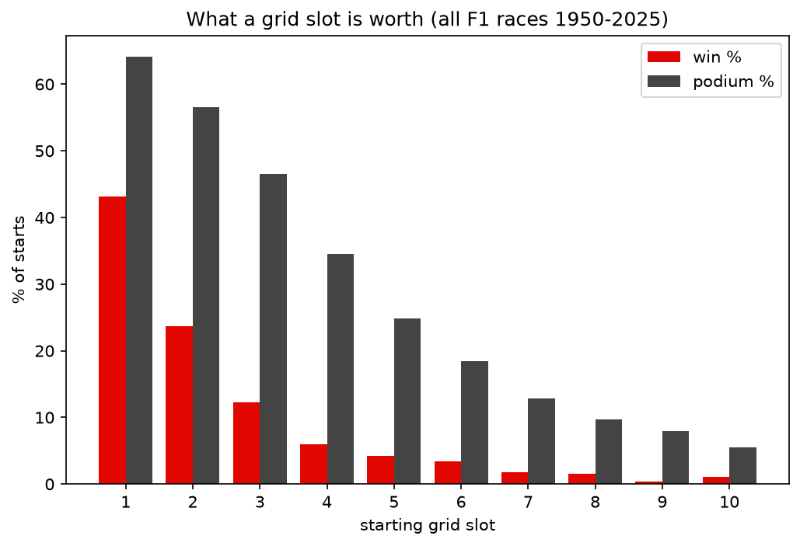
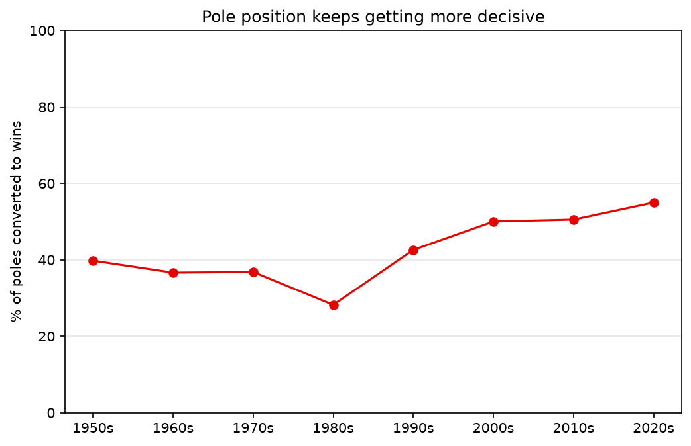
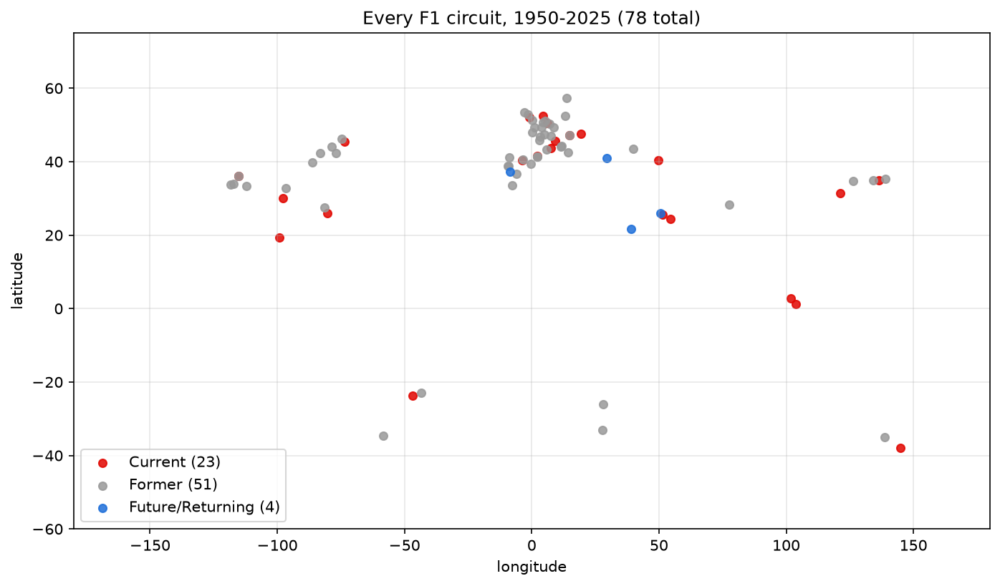

# F1 Data Project

A small data collection project that builds a clean dataset of Formula 1 history from two independent sources: the Jolpica F1 API (an Ergast-compatible API) and Wikipedia. The goal is to have circuit information and every race result since 1950 as tidy CSV files, ready for analysis.

## Data sources

1. **Jolpica F1 API** (https://api.jolpi.ca) - circuits and full race results, 1950 to present.
2. **Wikipedia** - the ["List of Formula One circuits"](https://en.wikipedia.org/wiki/List_of_Formula_One_circuits) table, with extra details the API does not have (circuit type, direction, length, number of Grands Prix held).

The two sources can be joined: `circuits_api.csv` keeps each circuit's Wikipedia URL, and both tables share circuit names.

## Project structure

```
F1/
├── collect_api.py      # main collector: fetches circuits + all race results from the API
├── websrcaping.py      # scrapes the Wikipedia circuits table into f1_circuits.csv
├── clean_data.py       # cleans data/results.csv into data/clean_results.csv
├── join_circuits.py    # joins the API and Wikipedia circuit tables into data/circuits_joined.csv
├── analyze.py          # grid vs. result analysis, writes data/grid_stats.csv
├── plot.py             # draws the three charts into plots/
├── script.py           # minimal API access check (one request, prints circuit count)
├── requirements.txt    # Python packages (requests, beautifulsoup4, matplotlib)
├── data/
│   ├── circuits_api.csv     # 78 circuits (id, name, Wikipedia URL, locality, country, lat/long)
│   ├── results.csv          # 26,313 rows: one row per driver per race, 1950 -> now
│   ├── clean_results.csv    # cleaned results used for the analysis
│   ├── circuits_joined.csv  # API circuits + Wikipedia details, one row per circuit
│   └── grid_stats.csv       # win % and podium % per starting slot
├── plots/
│   ├── grid_value.png       # what a starting slot is worth
│   ├── pole_conversion.png  # poles converted to wins, per decade
│   └── circuit_map.png      # every circuit on a world map
├── raw/
│   └── api/               # every API response cached as JSON, one file per page
├── f1_circuits.csv     # scraped Wikipedia table (type, direction, length, GPs held, status)
└── circuits.json       # sample raw API response (first circuits page)
```

## The datasets

### data/results.csv

One row per driver per race. Columns include:

- **Race**: season, round, race name, date, circuit id
- **Driver**: id, code, full name, nationality, date of birth
- **Constructor**: id, name, nationality
- **Result**: grid position, finishing position, points, laps, status (Finished / Engine / Collision / ...), race time, fastest lap

### data/circuits_api.csv

One row per circuit from the API: id, name, Wikipedia URL, locality, country, latitude, longitude.

### f1_circuits.csv

One row per circuit from Wikipedia: circuit type (street/road/race), direction, location, country, lap length, turns, which Grands Prix it hosted, seasons, number of GPs held, and a derived status column (Current / Former / Future).

## How to run

```bash
pip install -r requirements.txt

# 1. Collect
python collect_api.py     # circuits + all results from the API
python websrcaping.py     # Wikipedia circuits table

# 2. Clean -> join -> analyze -> plot
python clean_data.py
python join_circuits.py
python analyze.py
python plot.py            # saves the charts into plots/
```

The data folder is already in the repo, so you can also skip step 1 and run only `clean_data.py`, `join_circuits.py`, `analyze.py` and `plot.py`.

`collect_api.py` caches every API response in `raw/api/` before parsing it. On a re-run, nothing is downloaded again - the CSVs are rebuilt from the cache in seconds. Delete `raw/api/` to force a fresh download.

Both scripts follow polite-client rules: a named User-Agent, one request per second, and every response saved to disk.

## Status

- [x] API access check (`script.py`)
- [x] Circuits from the API
- [x] All race results 1950 -> now (26,313 rows)
- [x] Wikipedia circuits table scraped
- [x] Join the two circuit tables and analyze

## Findings

The question: does Saturday (the starting slot) decide Sunday (the race result)? The analysis covers 25,201 race starts from 1950 to 2025 (the Indianapolis 500 is removed, see `clean_data.py`).

### The starting slot matters a lot, and then it fades fast



- Pole position wins **43.1%** of the time and reaches the podium **64.1%** of the time.
- Second on the grid wins 23.7% and third 12.3%. By fourth place the win rate is down to 6.0%.
- From about seventh on the grid, a win is rare, but a podium is still possible.

### Pole position has become more decisive since the 1980s



- In the 1950s to 1970s, about 37-40% of poles turned into wins. The 1980s were the low point at **28.2%**.
- Since then it has climbed every decade: 42.6% in the 1990s, 50.0% in the 2000s, 50.5% in the 2010s and **55.0%** in the 2020s (2020-2025).

### Where F1 has raced



- 78 circuits have hosted a Formula 1 race: 23 are current, 51 are former and 4 are future or returning.
- Most circuits are in Europe, with the rest spread across North America, Asia, the Middle East and Australia. Former circuits are mostly in Europe and North America.
